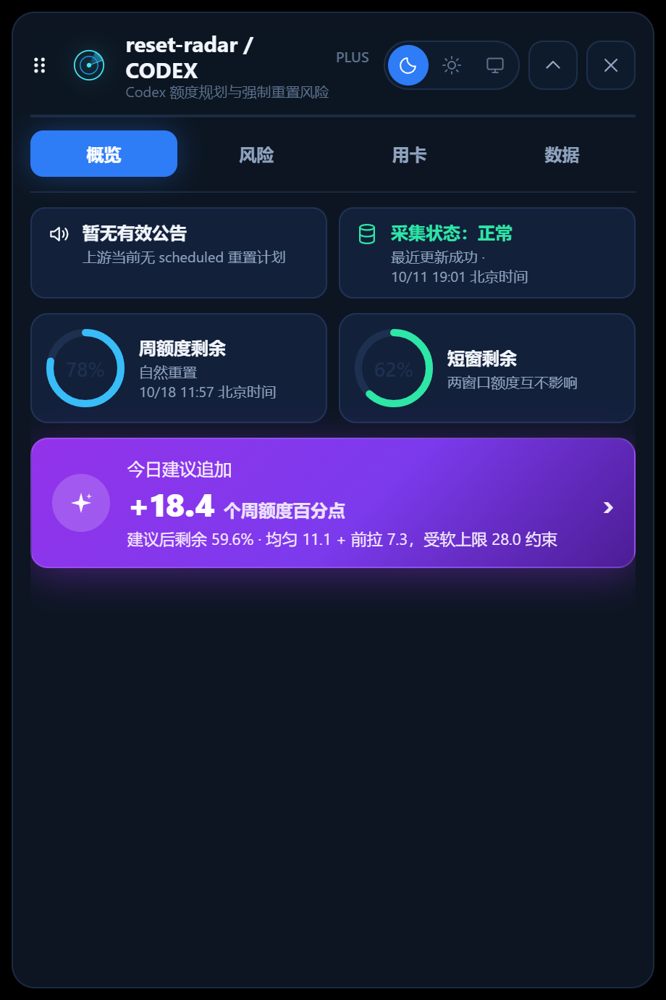

# reset-radar · 重置雷达

> 看得见准头的 Codex 重置风险与用卡规划器。
> A Codex reset-risk & credit planner that **proves its own accuracy**.

[](https://github.com/thequipster/reset-radar/actions/workflows/ci.yml) [](LICENSE) [](ROADMAP.md)

## 为什么做这个

现有的 Codex 额度悬浮窗会告诉你"明天强制重置风险 70%"，但从来没人回答：**这个 70% 说过几次准几次？**
reset-radar 的核心差异是**校准闭环**——每条风险预测都被落盘记录，事后与实际重置对答案，
命中率与 Brier 分数直接算给你看。模型准不准，摆在明面上，而不是藏在公式里。

## 界面

悬浮胶囊常驻显示当前重置风险（真实数据截图）：


点击胶囊展开分页面板，四页签切换：**概览**（公告 / 余额 / 今日建议）/ **风险**（分数 + 可解释因子逐条列出）/
**用卡**（决策 + 期望收益 + 24h/48h 碰撞概率）/ **数据**（采集状态与校准摘要）：



> 深浅双主题随时切换（默认深色）。验收/截图可用 hash 入口直达指定页签复现
> （如 `#expanded&tab=risk`；`pwsh scripts/shot-expanded.ps1` 支持 `-Theme light` 等参数）。

## 功能清单（v0.1.0）

- [x] 📡 **重置风险雷达**：星期基线 + 历史校准的强制重置概率，每个数字附带可解释因子
  （"为什么是这个数"一条条列出来）。
- [x] 🏃 **每日配速建议**：把剩余额度按风险摊到每天，公式三行说完，不搞黑盒。
- [x] 🎴 **重置卡规划器**：期望增量模型告诉你"今天用卡/等到周几用/这周期别用"，
  并给出"用卡后 24h/48h 撞上强制重置"的概率。
- [x] 📝 **预测落盘**：每日评估幂等追加到 `data/predictions.jsonl`（同日只在风险漂移超阈值时
  补行），只追加不修改——校准闭环的原料。
- [x] 🎯 **校准报告**：`npm run calibrate` 输出命中率、Brier 分数与逐周趋势
  （应用内校准摘要已入「数据与校准」页；深化面板见 [ROADMAP.md](ROADMAP.md) v0.2）。
- [x] ⚡ **秒开**：快照持久化 + 热启动，首屏先画上次数据再后台刷新。
- [x] 🔒 **本地优先**：无遥测、无账号；鉴权完全交给本机 `codex` CLI（app-server stdio），
  本应用不经手任何密钥。
- [x] 🖥️ **应用内校准摘要**：「数据与校准」页只读展示应用目录 `calibration.json` 摘要
  （正常/缺失/无效三态，零样本如实标注"数据积累中"，RR28）。
- [ ] 🗃️ 预测自动落盘到应用数据目录：现为脚本管线（`npm run log-prediction`）落盘
  `data/predictions.jsonl`，应用内暂不接入（[ROADMAP.md](ROADMAP.md) v0.2+）。

## 校准闭环怎么跑（差异化核心）

```bash
npm run log-prediction   # 每日一次：评估当日风险并幂等落盘（建议挂定时任务）
npm run calibrate        # 随时对答案：输出命中率/Brier/逐周趋势报告
```

预测行的 schema 与幂等规则见 `src/lib/predictions.ts`（单一实现源，100% 单测）。

## 技术栈

Tauri 2 · React · TypeScript（核心算法为零依赖纯函数，100% 单测）· vitest · GitHub Actions

架构详见 [docs/ARCHITECTURE.md](docs/ARCHITECTURE.md)。

## 开发

```bash
npm install
npm run tauri dev     # 开发运行
npx vitest run        # 前端与纯核心测试
npm run test:node     # scripts顶层与嵌套Node测试；与CI/发布流水线同入口
npm run tauri build   # 构建（注意：gnu 本机构建需 custom-protocol 特性，见 RUNBOOK §10）
```

发布资产门禁（本地复现 CI 检查）：

```bash
node scripts/check-release.mjs         # 版本两处同步 + README 链接可达
python scripts/check-ci.py             # ci.yml 结构与Node测试必跑（RR02/RR19）
python scripts/check-release-wf.py     # release.yml 结构（RR11）
```

本项目由「永续看板循环」驱动迭代：AI 工位按 [RUNBOOK.md](RUNBOOK.md) 协议领卡开发，
一切进度与证据见 [BOARD.md](BOARD.md) 与 [task_logs/](task_logs/)。

## 发布（用户操作，共三步）

仓库已配置打 tag 自动构建（Windows MSVC 产物：nsis `.exe` + msi + SHA256SUMS 挂 Release）：

```bash
gh repo create <owner>/reset-radar --public --source . --remote origin   # ① 建 GitHub 仓库（仅首次）
git push -u origin main                                                  # ② 推主干（CI 首跑=门禁验证）
git tag v0.1.0 && git push origin v0.1.0                                 # ③ 打版本 tag → 自动出 Release
```

版本号两处（`package.json` + `src-tauri/tauri.conf.json`）已锁定 `0.1.0` 且有门禁校验同步；
tag 名会与版本做一致性校验，不一致构建即失败。CI/release 的真实首跑发生在用户首次 push 后。

## 致谢与许可

- [codex-cockpit](https://github.com/HouSiyuan2001/codex-cockpit)（MIT，v0.3.0-beta.5，
  Copyright (c) 2026 Quota Float contributors）：
  风险因子、配速公式、重置卡规划器与 app-server 握手的算法思路来源，逐文件出处见
  [TRUTH.md](TRUTH.md) §1 与各卡 `task_logs/*_done.md`；
  部分代码为注明出处的逐行移植，复用清单与其 MIT 许可全文见
  [THIRD_PARTY_NOTICES.md](THIRD_PARTY_NOTICES.md)。
- [codex-resets.com](https://codex-resets.com) 的公开数据与接口。

本项目基于 [MIT License](LICENSE) 开源。

---

*Status: v0.1.0 发布就绪（RR01–RR41 除 RR30 待用户 CI 首跑外已全部闭环，REVIEW 验收循环持续滚动，历轮报告见 `docs/review-*.md`）。此仓库由 AI 工位按 [RUNBOOK.md](RUNBOOK.md) 协议自主推进，迭代计划见 [ROADMAP.md](ROADMAP.md)。*
